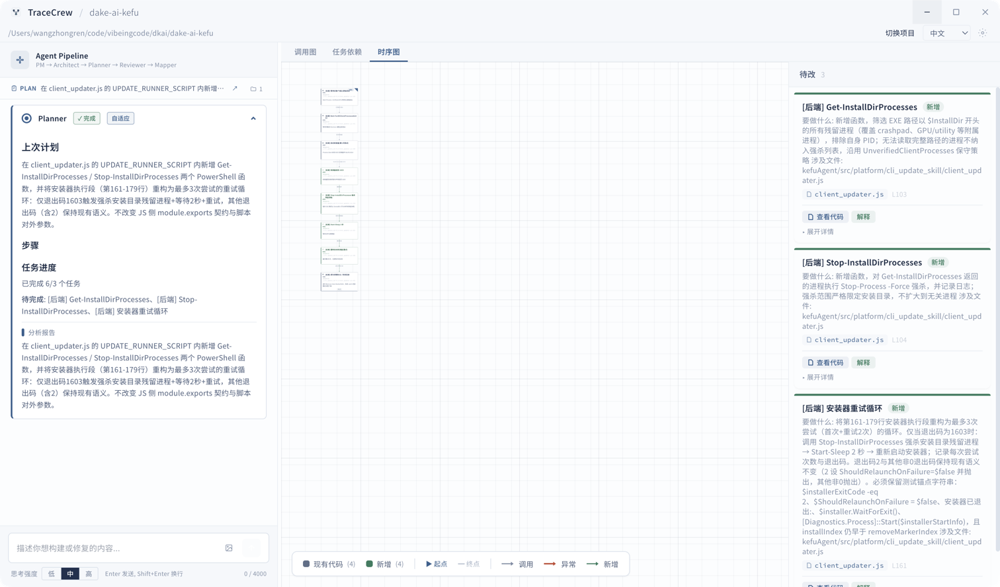

#  TraceCrew

> **A multi-agent collaborative IDE for code understanding and explanation.** A structured agent crew replaces the single-agent paradigm — achieving large-model quality code understanding and explanation with a team of smaller, specialized models.

## Why TraceCrew

A single large model juggling architecture analysis, code search, editing, and verification in one context window inevitably hits ceiling effects: token costs explode, role confusion creeps in, and quality degrades. TraceCrew splits the work across a crew of specialized agents, each owning a narrow domain:

```
Single Agent:                           TraceCrew Crew:

One brain does everything               PM         — requirements clarification
  ├── understand project structure      Architect  — IoC framework design
  ├── search codebase                   Planner    — architecture analysis & planning
  ├── plan changes                      Reviewer   — evidence verification
  ├── write code                        Mapper     — dependency graph & sequence diagram

Token cost: $$$$                        Each agent is small, focused, and auditable
No oversight, role confusion            Checks & balances between stages catch errors early
                                        Token cost: $
                                        Clear division of labor, structured validation
```

**Flow:** `PM → Architect → Planner → Reviewer → Mapper → Dependency Graph`. Read-only questions take the short path: PM explains, then automatically hands the chain to Mapper to draw (explain-then-draw).

## Interface



*Interface overview of a restored session: the Planner card on the left recaps the last plan (summary, steps, analysis report); the canvas shows the sequence-diagram view with its legend; the pending list on the right describes each affected node with「查看代码」and「解释」actions; the input bar carries the Low / Mid / High thinking-effort selector.*

```
┌─────────────────────┬──────────────────────────────────────────────┐
│                     │                                              │
│    Chat Panel       │           Graph View                         │
│                     │                                              │
│  PM (需求澄清)      │  ┌ 🔗调用图 │ 🔀依赖关系 │ ⏱️时序图 ────┐  │
│    ↓                │  │                                      │  │
│  Architect (框架)   │  │  ○ ───→ ○ ───→ ○                    │  │
│    ↓                │  │   │       │                           │  │
│  Planner (方案)     │  │   ○ ──→── ○ ───→ ○ ──→ ○            │  │
│    ↓                │  │   │               │                   │  │
│  Reviewer (审查)    │  │   ○ ───→── ○ ───→── ○                │  │
│    ↓ (pass/reject)  │  └──────────────────────────────────────┘  │
│  Mapper (画图)      │                                              │
│                     │  ┌──── 待改列表 ──────────────────────┐      │
│  ↻ retry on fail   │  │  3                                  │      │
│                     │  │                                    │      │
│  PlanCard           │  │ ┌ [前端] 通知弹窗组件 ────────────┐ │      │
│  ReviewCard         │  │ │ Planner: 需要新增...           │ │      │
│  ArchitectCard      │  │ │ [解释]                         │ │      │
│  Tool calls inline  │  │ └────────────────────────────────┘ │      │
│                     │  │ ┌ [后端] IPC handler ─────────────┐ │      │
│  [input] [Send]     │  │ │ ...                             │ │      │
│                     │  │ └────────────────────────────────┘ │      │
│                     │  └────────────────────────────────────┘      │
└─────────────────────┴──────────────────────────────────────────────┘
```

## Agent Crew

| Agent | Role | Responsibility |
|-------|------|----------------|
| **PM** | Project Manager | Clarifies requirements with the user, asks targeted questions, produces confirmed requirement document |
| **Architect** | Framework Designer | Designs IoC-driven architecture: module boundaries, interface contracts, dependency rules, directory skeleton. Saves to `.tracecrew/ARCHITECTURE.md`. Skips when existing architecture is sufficient |
| **Planner** | Technical Planner | Analyzes requirements against architecture, explores codebase, identifies affected files, outputs structured execution plan |
| **Reviewer** | Inspector | Verifies Planner's analysis against real code evidence — each claim must cite a file:line. Pass or send back with feedback |
| **Mapper** | Cartographer | Converts approved plan into three views: call graph, task dependency graph, and sequence diagram |

**Pipeline:** PM clarifies → Architect designs IoC framework → Planner creates execution plan → Reviewer verifies → Mapper draws graphs. If Reviewer rejects, Planner revises. Architect is skipped when existing architecture covers the new requirement.

### Node States

| State | Icon | Meaning |
|-------|------|---------|
| `planned_new` | ◉ | New node to implement |
| `problem` | ✕ | Issue detected, needs fixing |
| `planned_change` | ✎ | Scheduled modification |
| `existing` | ○ | Existing code, no action needed |
| `done` | ✓ | Completed |

Each node card shows: label, status badge, Planner analysis detail, file path, and an action button (explain). Running「解释」generates a Markdown explanation of the node and exports it to `.tracecrew/explanations/`.

## Features

### Core
- **Multi-Agent Pipeline** — PM → Architect → Planner → Reviewer → Mapper with automatic retry on rejection
- **IoC Architecture Design** — Architect agent designs interface contracts, module boundaries, and dependency rules. Persisted as `.tracecrew/ARCHITECTURE.md`, auto-skipped when unchanged
- **Three Graph Views** — Call graph (TB), task dependency graph (LR), and sequence diagram — switchable via tabs
- **Bug Impact Analysis** — `impact_scope` highlights trigger paths (red) and affected nodes (orange dashed) on the graph
- **Explain-Then-Draw** — Ask PM about any flow or structure: it explains, then automatically hands the chain to Mapper and the graph appears on the canvas
- **Explain & Export** — Click a node card's「解释」button to generate a Markdown explanation of just that node; automatically exported to `.tracecrew/explanations/`
- **Plan Versioning** — Multiple Planner revisions shown in popup viewer with diff comparison

### Streaming & Feedback
- **SSE Streaming** — Real-time agent output per node, with live token display in expanded card
- **Reasoning Display** — LLM reasoning tokens shown in collapsible "💭 思考过程" section
- **Tool Call Badges** — All tool invocations (read, search, list, run, create, edit, delete) shown inline inside agent chat bubbles

### Developer Experience
- **Code Viewer** — Right panel shows source file at function definition line
- **Markdown Rendering** — Planner analysis, review feedback, and agent output rendered via `react-markdown` + GFM
- **Resizable Panels** — ChatPanel and CodeViewer widths independently adjustable via drag handles
- **Custom Title Bar** — Frameless window with native macOS traffic light buttons
- **State Persistence** — Work progress (pipeline phase, graph, execution records) survives restarts

### Internationalization
- **i18n** — Chinese (zh-CN), English (en), Japanese (ja), Korean (ko)

## Tech Stack

| Layer | Technology |
|-------|-----------|
| **Desktop Shell** | Electron 34 |
| **Frontend** | React 19, TypeScript, Tailwind CSS, Vite 6 |
| **Backend** | Express 5 (embedded in Electron main process) |
| **Database** | better-sqlite3 |
| **LLM SDK** | OpenAI SDK 6 (compatible with any OpenAI-API provider) |
| **Graph Layout** | dagre 0.8 |
| **Markdown** | react-markdown + remark-gfm |
| **State** | zustand 5 |

## Quick Start

### Prerequisites

- Node.js 20+
- An LLM provider with OpenAI-compatible API (OpenAI, DeepSeek, etc.)

### Setup

```bash
git clone https://github.com/wangzhongren/TraceCrew.git
cd TraceCrew/frontend
npm install
```

### Configure LLM

Create a `.env` file in the project root (`TraceCrew/`):

```bash
cp .env.example .env
```

Edit `.env`:

```env
TRACECREW_LLM_API_KEY=sk-...
TRACECREW_LLM_BASE_URL=https://api.openai.com/v1
TRACECREW_LLM_MODEL=gpt-4o
```

> Supports any OpenAI-compatible API. Use smaller models (e.g. `deepseek-v4-pro`) for cost efficiency — the crew architecture is designed for small models.

### Run

```bash
cd frontend
npm run electron:dev
```

### Production Build

```bash
cd frontend
npm run electron:build
```

## Project Structure

```
TraceCrew/
├── frontend/                  # Electron + React app
│   ├── src/
│   │   ├── components/
│   │   │   ├── ChatPanel.tsx      # Agent chat + timeline
│   │   │   ├── MapperView.tsx     # Dependency graph + pending list
│   │   │   ├── MapCanvas.tsx      # SVG node-link diagram
│   │   │   ├── RightPanel.tsx     # Code viewer side panel
│   │   │   ├── ActionDialog.tsx   # Per-node action buttons
│   │   │   ├── PlanCard.tsx       # Planner report card
│   │   │   ├── ReviewCard.tsx     # Reviewer verdict card
│   │   │   └── ...
│   │   ├── i18n/                  # zh-CN, en, ja, ko
│   │   ├── types/                 # Theme colors, status definitions
│   │   └── App.tsx                # Root layout + state orchestration
│   └── package.json
├── electron/
│   ├── main.ts                    # Electron main process
│   ├── fileManager.ts             # File system operations
│   └── server/
│       └── services/
│           └── agent.ts           # Agent system prompts + LLM orchestration
├── .env.example
└── README.md
```

## Project Data

| Path | Purpose |
|------|---------|
| `.tracecrew/ARCHITECTURE.md` | Architect's IoC framework design (modules, interfaces, dependency rules) |
| `.tracecrew/tracecrew.db` | SQLite database (file summaries, change queue) |
| `.tracecrew/TASKLOG.md` | Append-only task completion log for context passing |
| `.tracecrew/PLAN.md` | Approved Planner report, survives restarts |
| `.tracecrew/backups/` | File backups before edits (with meta.json) |
| `.tracecrew-logs/` | Shell execution logs |

## License

Apache License, Version 2.0. See [LICENSE](LICENSE).

Copyright 2026 wangzhongren
