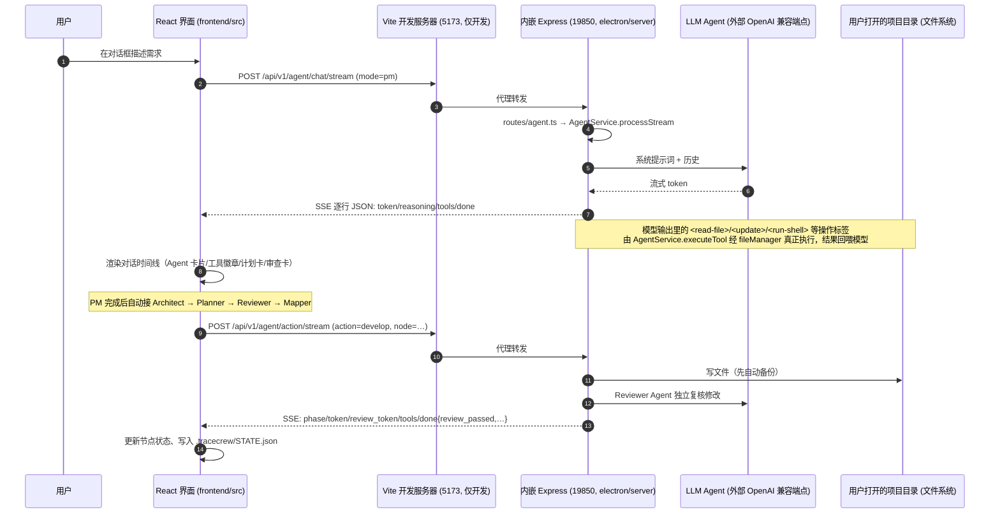
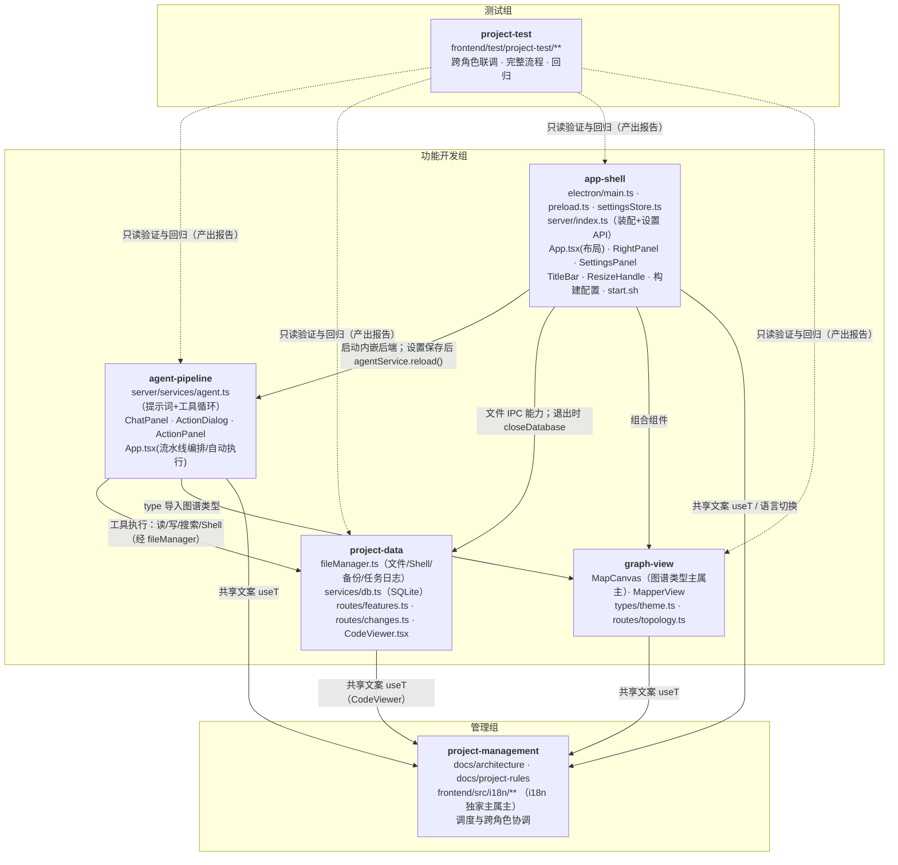

# TraceCrew 整体架构（当前态）

> 建立：2026-10-16（项目管理基线交付物）。本文描述代码里**真实存在**的结构，不是规划稿；每节内容都能在源码中找到依据。
> 阅读入口：[系统是什么](#1-tracecrew-是什么) · [开发角色分工](#2-六个开发角色的分工) · [请求怎么走](#4-一次需求从界面到后端的完整路径) · [公共契约](#5-公共契约概览) · [已知存量偏差](#8-已知存量偏差)

## 1. TraceCrew 是什么

TraceCrew 是一个跑在桌面上的**多 Agent 协作代码智能 IDE**（Electron 应用；代码里仍残留旧名 CodeAtlas，见第 8 节）。它替代「一个大模型在一个上下文里同时做需求、找码、改码、验证」的做法，改成一组专职的小模型 Agent 分工协作，每一步都有独立审查。

用户先打开一个项目文件夹，然后：

1. 用自然语言描述任务；
2. 一组 LLM Agent 依次工作：**PM**（需求澄清）→ **Architect**（框架设计）→ **Planner**（分析并产出计划）→ **Reviewer**（独立审查计划）→ **Mapper**（画出调用图、任务依赖图、时序图）；
3. 用户在图上对单个节点点「开发 / 修复 / 重构 / 测试 / 解释」，或点「一键执行」让所有待办节点按依赖顺序自动执行；每个**写操作**完成后由独立 Reviewer 复核，不通过则自动返修；
4. 所有文件读写都发生在用户打开的那个项目目录里，改动前自动备份，删除进回收目录。

技术组成（以 `frontend/package.json` 与源码为准）：

| 部件 | 技术 | 位置 |
| --- | --- | --- |
| 桌面外壳 | Electron 34（34.5.4） | `electron/main.ts`、`electron/preload.ts` |
| 内嵌后端 | Express 5，固定端口 19850 | `electron/server/` |
| 前端 | React 19 + Vite 6 + Tailwind | `frontend/src/` |
| 图谱布局 | dagre | `frontend/src/components/MapCanvas.tsx` |
| 本地数据 | better-sqlite3（每个项目一个库） | `electron/server/services/db.ts` |
| LLM 接入 | openai SDK（OpenAI 兼容端点） | `electron/server/services/agent.ts` |
| 国际化 | 自建 locale Context（zh-CN / en / ja / ko） | `frontend/src/i18n/` |

## 2. 六个开发角色的分工

项目把开发工作分给 6 个固定角色。每个角色在自己的 `角色卡/<role>/` 目录里维护角色卡、边界、memo 与功能导航；**能改哪些文件以各自 boundary.md 的 Section 1 为准，本文不复述边界表**。除项目管理外，各角色的 `feature-map.md` 目前都尚未创建。

| 角色 | 组别 | 一句话职责 | 功能导航 |
| --- | --- | --- | --- |
| agent-pipeline | 功能开发组 | 多 Agent 协作流水线本身：对话、计划、审查、执行 | `角色卡/agent-pipeline/feature-map.md`（待创建） |
| app-shell | 功能开发组 | Electron 外壳与装配：主进程、IPC 桥、内嵌后端、设置、构建配置 | `角色卡/app-shell/feature-map.md`（待创建） |
| graph-view | 功能开发组 | 图谱可视化：三图渲染与交互、图谱类型、拓扑接口 | `角色卡/graph-view/feature-map.md`（待创建） |
| project-data | 功能开发组 | 文件与数据：文件读写/编辑/搜索/备份、Shell 执行、SQLite | `角色卡/project-data/feature-map.md`（待创建） |
| project-management（本文作者） | 管理组（组长） | 跨角色调查与整体架构、共享资产（i18n）、调度与协调 | [feature-map.md](../feature-map.md) |
| project-test | 测试组（组长） | 独立验证跨角色接口、完整流程与回归 | `角色卡/project-test/feature-map.md`（待创建） |

### agent-pipeline（Agent 协作流水线）
产品核心能力的归属角色：PM 需求澄清、Architect 框架设计、Planner 计划、Reviewer 审查、Mapper 画图、Executor 动作执行、自动执行编排，以及文件摘要服务与对话界面。
主要文件：[`electron/server/services/agent.ts`](../../../electron/server/services/agent.ts)（`AgentService` 单例，全部系统提示词与工具循环）、[`frontend/src/components/ChatPanel.tsx`](../../../frontend/src/components/ChatPanel.tsx)（流水线前端编排）、[`ActionDialog.tsx`](../../../frontend/src/components/ActionDialog.tsx)、[`ActionPanel.tsx`](../../../frontend/src/components/ActionPanel.tsx)、[`frontend/src/App.tsx`](../../../frontend/src/App.tsx) 的调度部分。

### app-shell（应用外壳与装配）
应用能不能启动、窗口能不能开、前后端能不能连上由它负责：Electron 主进程（窗口、IPC 处理器、生命周期）、preload IPC 桥契约、内嵌 Express 装配与设置 API、LLM 设置持久化（`.env`）、构建/测试配置、前端入口与布局框架、启动脚本。
主要文件：[`electron/main.ts`](../../../electron/main.ts)、[`electron/preload.ts`](../../../electron/preload.ts)、[`electron/settingsStore.ts`](../../../electron/settingsStore.ts)、[`electron/server/index.ts`](../../../electron/server/index.ts)、[`RightPanel.tsx`](../../../frontend/src/components/RightPanel.tsx)、[`SettingsPanel.tsx`](../../../frontend/src/components/SettingsPanel.tsx)、[`TitleBar.tsx`](../../../frontend/src/components/TitleBar.tsx)、[`ResizeHandle.tsx`](../../../frontend/src/components/ResizeHandle.tsx)、`frontend/` 各配置文件、[`start.sh`](../../../start.sh)。

### graph-view（图谱视图）
调用图、任务依赖图、时序图的渲染与交互；图谱数据模型（`MapCanvas.tsx` 导出的 `CallGraph` / `GraphNode` / `GraphEdge`）与视觉常量（`types/theme.ts`）；拓扑数据接口。
主要文件：[`MapCanvas.tsx`](../../../frontend/src/components/MapCanvas.tsx)、[`MapperView.tsx`](../../../frontend/src/components/MapperView.tsx)、[`frontend/src/types/theme.ts`](../../../frontend/src/types/theme.ts)、[`electron/server/routes/topology.ts`](../../../electron/server/routes/topology.ts)。

### project-data（项目数据与文件）
文件读写/行级编辑/搜索/备份、Shell 执行与任务日志、SQLite 持久化（features / change_queue / meta / file_summaries 四张表）、功能分析与变更记录路由、代码查看器。
主要文件：[`electron/fileManager.ts`](../../../electron/fileManager.ts)、[`electron/server/services/db.ts`](../../../electron/server/services/db.ts)、[`electron/server/routes/features.ts`](../../../electron/server/routes/features.ts)、[`electron/server/routes/changes.ts`](../../../electron/server/routes/changes.ts)、[`electron/server/types.ts`](../../../electron/server/types.ts)、[`CodeViewer.tsx`](../../../frontend/src/components/CodeViewer.tsx)。

### project-management（项目管理，本角色）
跨角色调查、整体架构与集成设计、共享基础资产（`frontend/src/i18n/**`）的独家主属主、任务调度与协调、项目工程规则（[docs/project-rules.md](project-rules.md)）。调查、设计、调度是本角色的**职责**而非业务功能，故没有业务功能文档。

### project-test（固定测试）
在独立上下文中验证跨角色接口、完整功能流程与回归结果；只写测试代码、测试夹具与报告，不改业务源码，发现问题回报给项目管理角色。测试目录：`frontend/test/project-test/`。

### 2.1 产品内部的 6 个 LLM Agent（不要与开发角色混淆）
运行在应用里的 Agent 是产品功能，归属 agent-pipeline：**PM / Architect / Planner / Reviewer / Mapper / Executor**。每个 Agent 可以单独配置 LLM（见 [5.5](#55-llm-配置契约)）。开发角色（上一节）是“做这个产品的人”，LLM Agent 是“这个产品里的工人”，两者是两套命名。

## 3. 主要模块与数据流

### 3.1 进程与启动

```
start.sh（仓库根）
  └─ cd frontend && npm run electron:dev（= vite，由 vite-plugin-electron 构建并启动 Electron）
       ├─ Electron 主进程 electron/main.ts
       │    ├─ dotenv 加载仓库根 .env
       │    ├─ 注册 IPC 处理器（window:* / file:* / shell:*）
       │    ├─ 启动内嵌 Express（端口 19850）← electron/server/index.ts
       │    └─ 创建无边框主窗口，加载 Vite 开发地址（5173）或打包后的 dist/index.html
       └─ Vite 开发服务器 5173（React 前端，/api 代理到 19850）
```

- 开发模式：窗口加载 `VITE_DEV_SERVER_URL`（5173），前端请求经 Vite 代理到 19850（`vite.config.ts` 对 `/stream` 请求专门关闭缓冲，保证 SSE 实时性）。
- 生产模式：主进程 `loadFile` 直接加载 `frontend/dist/index.html`；Express 只服务 `/assets` 静态资源与 `/api` 路由（`server/index.ts` 注释里提到的 SPA fallback 实际未实现，也不需要——Electron 直接加载文件）。

### 3.2 两条通信通道（面向初学者）

前端与后端之间有**两条**通道，用途不同：

1. **IPC（进程内调用）**：文件读写、搜索、Shell 执行、窗口控制。走 Electron 的 `contextBridge`：`electron/preload.ts` 把 `window.tracecrew` 暴露给页面，`electron/main.ts` 用 `ipcMain.handle` 接住。特点：本机进程间调用，能访问文件系统；前端调用形如 `await window.tracecrew.file.readFile(path)`。
2. **HTTP + SSE（网络请求）**：LLM 流水线、动作执行、设置读写。前端 `fetch` 到 `/api/v1/...`（开发经 5173 代理，实际到 19850）。特点：可以流式输出（Server-Sent Events），把模型逐字返回的内容实时显示出来。

### 3.3 HTTP/SSE API 一览（`electron/server/index.ts` 挂载）

| 前缀 | 端点 | 用途 | 实现状态 |
| --- | --- | --- | --- |
| `/api/v1/agent` | `POST /chat`、`POST /chat/stream`（SSE） | 按 mode（pm/architect/planner/mapper/executor/reviewer）跑 Agent 工具循环 | 在用 |
| | `POST /classify-intent` | 判断指令是 execute 还是 readonly | 在用 |
| | `POST /name-plan` | 给计划起短文件名 | 在用 |
| | `POST /plan/stream`（SSE） | Planner 计划流 | 在用 |
| | `POST /step/stream`（SSE） | 子执行器按步骤跑 | 在用 |
| | `POST /action/stream`（SSE） | 动作执行 + 独立 Reviewer 复核 + 返修 | 在用（核心） |
| `/api/v1/features` | 多个端点 | 功能树分析 | 大多为占位（“Not yet migrated”） |
| `/api/v1/changes` | `POST /summarize`、`GET /pending` | 变更队列 | 在用（简单实现） |
| `/api/v1/topology` | `GET /stream`、`POST /refresh` | 拓扑刷新 | 占位/心跳实现 |
| `/api/v1/settings` | `GET` / `POST` | 每 Agent LLM 配置读写 | 在用 |
| `/api/v1/health` | `GET` | 健康检查 | 在用 |

### 3.4 持久化

每个被打开的项目，在**它自己的目录**下生成 `.tracecrew/`：

| 路径 | 内容 | 写入方 |
| --- | --- | --- |
| `.tracecrew/STATE.json` | 当前图谱、时序图、计划的快照（打开项目时恢复） | 前端 App.tsx |
| `.tracecrew/ARCHITECTURE.md` | Architect 产出的架构设计（Markdown + JSON） | 前端 ChatPanel |
| `.tracecrew/plans/<日期>-<slug>.md`、`latest.md`、`README.md` | 历次计划与索引 | 前端 ChatPanel |
| `.tracecrew/tracecrew.db` | SQLite（WAL）：features、change_queue、meta、file_summaries | 后端 db.ts |
| `.tracecrew/TASKLOG.md` | 已完成节点的追加式任务日志（喂给后续节点做上下文） | 后端 fileManager.appendTaskLog |
| `.tracecrew/backups/<id>/` | 每次写文件前的自动备份（`before` + `meta.json`） | 后端 fileManager |
| `.tracecrew/deleted/` | 删除保护回收站 | 后端 fileManager |
| `.tracecrew-logs/` | Shell 执行日志文件 | 后端 fileManager.runShell |

## 4. 一次需求从界面到后端的完整路径

以“用户描述一个需求，直到图上出现任务节点”为例（顺序图）：



要点：

1. **界面发送**：`ChatPanel.tsx` 把用户消息 POST 到 `/api/v1/agent/chat/stream`，带 `mode`（pm/architect/planner/…）、`project_path`、`locale`、历史消息。
2. **后端执行**：`routes/agent.ts` 调 `agentService.processStream()`。它选系统提示词、调对应 Agent 的模型（流式），把模型输出里的类 XML 操作标签（`<read-file>`、`<update>`、`<create-file>`、`<run-shell>`、`<search>` 等）解析为工具操作，经 `fileManager` 真正执行，结果回喂模型进入下一轮；模型输出 `<final/>` 或 `<done/>` 结束，最多 50 轮。
3. **事件回来**：每个事件一行 JSON（`{"event":"…","data":…}` + 换行）。前端按行拆分解析，Append 进对话时间线。
4. **流水线接力**：ChatPanel 检测到 PM 输出 `<handoff-to-planner/>` 后，自动依次运行 Architect → Planner → Reviewer → Mapper；Mapper 产出 `call_graph` 与 `sequence_graph` JSON 后写入 `PipelineState`，界面切换到图谱。
5. **动作执行**：用户点节点操作（或“一键执行”）时，App.tsx POST `/api/v1/agent/action/stream`，后端先由执行 Agent 改码（写前自动备份），再把改动交给独立的 Reviewer Agent 复核，不通过则带反馈返修（最多 10 轮）。结果里含 `review_passed`、`updated_node`、`need_replan`。
6. **一键执行**：App.tsx 对非完成节点做拓扑排序（只统计两端都在集合内的依赖边），逐个复用第 5 步；依赖未完成的节点跳过；通过后节点状态改为 `done` 并持久化。

## 5. 公共契约概览

### 5.1 SSE 事件流（后端 ↔ 前端）
后端把每个事件写成**一行 JSON**：`JSON.stringify({ event, data }) + '\n'`；前端按 `\n` 切分逐行解析。事件名（源码位置：`electron/server/routes/agent.ts` 与 `AgentService` 各生成器）：

| 端点 | 事件名 | 含义 |
| --- | --- | --- |
| `/chat/stream`、`/plan/stream`、`/step/stream`、`/action/stream` 通用 | `token` / `review_token` / `plan_token` / `step_token` | 模型逐字输出（按阶段区分前缀） |
| | `reasoning` | 模型思考过程（如端点支持） |
| | `tools` | 本轮执行了哪些工具操作（type + file 列表） |
| | `phase` | 动作流的阶段：`action` → `review` →（失败时 `fix`） |
| | `done` | 结束事件；动作流内含 `success`、`message`、`review_passed`、`review_feedback`、`review_issues`、`updated_node`、`need_replan` 等 |
| `/plan/stream` | `plan` / `plan_error` | 计划 JSON / 失败 |
| `/step/stream` | `step_done` / `step_error` | 子执行器结果 |
| `/topology/stream` | `connected` / `ping` | 连接与心跳（SSE 保活） |

注意：前端还预留了 `remap_token` 事件与 `remap` 阶段的处理，但当前后端代码不会发出（见第 8 节偏差 7）。

### 5.2 preload 契约（`window.tracecrew`）
`electron/preload.ts` 通过 `contextBridge` 暴露的对象，是前端访问本机能力的**唯一入口**；类型镜像在 `frontend/src/types/electron.d.ts`（两者要同步维护，同属 app-shell）。分组：

- `file`：`openProject`、`listDirectory`、`readFile`、`writeFile`、`insertLines`、`replaceLines`、`deleteLines`、`deleteFile`、`search`、`restoreBackup`、`getProjectPath`、`openFile`、`onProjectOpened`（事件）。
- `shell`：`run`、`kill`、`getLogFile`、`readLog`、`onData`/`onDone`/`onError`（事件）。
- `backend`：`getUrl()`（硬编码 `http://localhost:19850`）。
- `window`：`minimize`、`maximize`、`close`、`isMaximized`、`openTerminal`（打开 AI 终端子窗口）、`openPlan`（用独立窗口查看计划 HTML）。
- `getAppIcon()`：应用图标 DataURL。

### 5.3 图谱类型（共享模型）
由 `frontend/src/components/MapCanvas.tsx` 导出，**主属主是 graph-view**，但被多个角色引用（这是一个存量偏差，见第 8 节偏差 2）：

- `GraphNode`：`id`、`label`、`kind`、`status`（`existing | problem | planned_change | planned_new | done`）、`detail`、`file?`、`line?`、`sub_components?`、`impact_scope?`、`lane?`、`step?`。
- `GraphEdge`：`from`、`to`、`label`、`status`（`existing | new | removed | error`）。
- `CallGraph`：`{ nodes: GraphNode[]; edges: GraphEdge[] }`（调用图、任务依赖图、时序图共用一个结构）。
- 视觉常量在 `frontend/src/types/theme.ts`（`STATUS_COLORS`、`EDGE_COLORS` 等；当前只被 MapCanvas 与 MapperView 使用）。

改字段前必须先更新设计并通知下游（App.tsx、ActionPanel、RightPanel 等都会受影响）。

### 5.4 动作类型契约
`ActionType = 'test' | 'fix' | 'refactor' | 'explain' | 'develop'`（`ActionDialog.tsx` 导出；节点状态 → 可用动作的映射 `getActionsForNode` 也在这里）。前后端以字符串对齐；后端映射到 `ACTION_SYSTEM_PROMPTS` 里的系统提示词。

### 5.5 LLM 配置契约
- 每 Agent 一组键：`TRACECREW_LLM_<AGENT>_API_KEY / _BASE_URL / _MODEL`，`<AGENT>` ∈ {PM, ARCHITECT, PLANNER, REVIEWER, MAPPER, EXECUTOR}。
- 回退链：每 Agent 键 → 旧版全局键 `TRACECREW_LLM_*`；此外 Architect 无 Key 时借用 Planner 的配置。
- 存两处：浏览器 `localStorage`（`tracecrew-llm-settings-v2`，面板即时用）+ 仓库根 `.env`（后端用，保存后同步 `process.env` 并 `agentService.reload()`，无需重启）。
- 详细规则与来源见 [docs/project-rules.md](project-rules.md)。

## 6. 角色协作图（角色 → 文件组 → 主要依赖方向）



读图提示：实线是代码依赖方向，虚线是验证关系（测试角色只读被验证对象）。i18n 被所有前端组件消费，所以四条“共享文案”线都指向项目管理角色。

## 7. 各角色的功能导航

各角色的业务功能文档归各自维护，本页只给导航入口：

- agent-pipeline：`角色卡/agent-pipeline/feature-map.md`（待创建）
- app-shell：`角色卡/app-shell/feature-map.md`（待创建）
- graph-view：`角色卡/graph-view/feature-map.md`（待创建）
- project-data：`角色卡/project-data/feature-map.md`（待创建）
- project-management（本角色，无业务功能）：[feature-map.md](../feature-map.md)
- project-test（无业务功能，报告链接受测文档）：`角色卡/project-test/feature-map.md`（待创建）
- 共享组件清单：`docs/architecture/shared-components.md`（待创建）

## 8. 已知存量偏差

以下都是**当前代码的真实状态**（2026-10-16 核对）。如实记录、不扩散；**是否整改、整改批次与优先级是客户待决策项**，本角色不擅自安排。

1. **Express 路由直连 services，跨过 Pipeline 层**：`routes/agent.ts` 直接调用 `agentService` 的各个方法；`routes/changes.ts`、`routes/features.ts` 直接导入 `services/db` 的函数。项目当前没有 `pipelines/` 目录。
2. **组件从 MapCanvas 导入图谱类型**：`App.tsx`、`ChatPanel.tsx`、`ActionDialog.tsx`、`ActionPanel.tsx`、`RightPanel.tsx`、`MapperView.tsx` 都用 `import type { … } from './MapCanvas'`。图谱类型是事实上的共享模型，但主属主是 graph-view 的组件文件。
3. **App.tsx 同时承担组合根与流水线编排**：既有布局接线（左右面板、标题栏），又有自动执行编排（拓扑排序、依赖检查、逐节点调用、状态持久化），还持有 `PipelineState` 类型（ChatPanel 反向导入）。
4. **fileManager.ts 承担多重职责并被跨层直接引用**：`main.ts`（IPC handler）与 `services/agent.ts`（工具执行）都直接 import 它；它没有 abstract/public/impl 分层。
5. **features 路由多为占位**：`routes/features.ts` 的 analyze / analyze-top / analyze-all / search 等端点返回空结果或 “Not yet migrated”。
6. **summarizer.ts 未接线**：`SummarizerService` 只在自身文件内定义，全仓库无引用；`file_summaries` 表建好了但没有生产者。
7. **前端预留了后端未发出的事件**：App.tsx / ActionPanel.tsx 处理 `remap_token` 与 `remap` 阶段，`electron/` 内没有任何 “remap” 字样。
8. **遗留命名 CodeAtlas**：`start.sh` 横幅写 “CodeAtlas Launcher”；健康检查返回 `service: 'code-atlas'`；仓库根有 `.codeatlas/` 目录与 `.codeatlas.lock`；`frontend/package.json` 的打包配置引用不存在的 `../backend/**`（历史遗留）。
9. ~~测试套件当前为红~~ **已闭环（2026-10-16）**：当时 43 例失败归类为 a=15（ABI）/ b=28（用例过时）/ c=1（实现缺陷：`searchInFiles` 恒空），实施中还发现缺陷 #2（`agent.ts` 把搜索响应对象当数组）。已按提案修复（测试运行方式迁移为 Electron Node，方案 A1；缺陷 #1/#2 相继修复）；现状 `npm test` = **4 文件、95/95、退出码 0**，M5 独立验证与启动冒烟通过。记录：[docs/fix/2026-10-16_fix_test-suite-red.md](fix/2026-10-16_fix_test-suite-red.md)、[docs/fix/2026-10-16_fix_search-in-files-empty.md](fix/2026-10-16_fix_search-in-files-empty.md)、[docs/scheduling/test-suite-red-fix.md](scheduling/test-suite-red-fix.md)。
10. **i18n 文案与实现漂移**：`chat.pipelineFlow` 仍写 “PM → Planner → Reviewer → Mapper”，而实际流水线已含 Architect。
