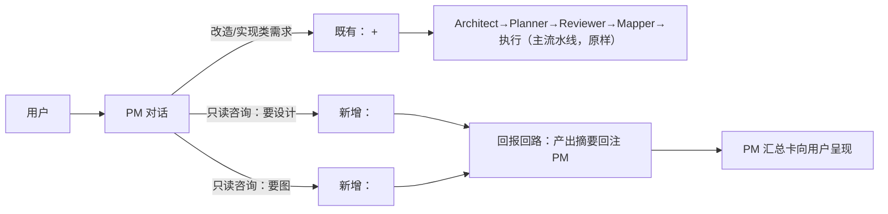

# PM 调度设计与画图（含回报回路与呈现流程）——设计方案

> 状态：**设计期，待客户确认**（方案 → 确认 → 实施 → 验证；全程不提交 git）。
> 需求原话（客户）：「显示流程是是不是改一下更好，pm 可以调度设计和画图更好呢。画图和设计都处理好了，和pm 汇报呢。」
> 需求解读：① PM 成为可调度的主接口——对话中把任务派给 **Architect（设计）** 与 **Mapper（画图）**；② 二者完成后**回报给 PM**，由 PM 汇总向用户呈现（回报回路）；③ 相应的**呈现流程**（多代理卡片顺序/状态/跳转）一并设计。

## 1. 现状调研（file:line 依据，2026-10-16）

- **主流水线**（改造需求）：用户 → PM（澄清；`<confirmed-requirement>` + `<handoff-to-planner/>`，agent.ts:100-146）→ Architect（设计；可 `<skip-architect/>` 复用存档；**无条件**进 Planner，ChatPanel:433-439/471）→ Planner（计划）→ Reviewer（评审；失败 500ms 后重启 Planner，ChatPanel:609-611）→ Mapper（**画图**：产出 call_graph + sequence_graph JSON，ChatPanel:615-691）→ 执行。
- **PM 侧**：`pmStream`（mode='pm'，ChatPanel:304）；`pmHistoryRef` 独立于流水线 history（119-120），handoff 时仅以「[PM] 摘要」桥接（341/371）；`pmState.active` 管理追问态（342/351）。
- **handoff 协议家族**：自闭合标签 + **仅无操作轮生效**（agent.ts:932 一带）+ 前端按键匹配；清理器 3 处触点：`PROTOCOL_TAG_NAMES`（ActionDialog.tsx:89）、`cleanDoneMessage`（agent.ts:719-731）、pm 重试提示（agent.ts:945）。`skip-architect`/`final`/`done` 同族。
- **图谱产出/挂载**：**只有 Mapper 产图**（call_graph 经 EDGE_STATUS_MAP 映射，ChatPanel:623-644；sequence_graph 676-682）；唯一挂载口 `onPipelineChange({phase,graph,sequenceGraph})`（685 或失败仅 phase:'done' 688）→ App `updatePipeline`（AX:69-71）→ MapperView 显示只需 `pipeline.graph/sequenceGraph`（MV:404-407）。
- **呈现**：结果卡四类（plan/review/graph/文本）在 AgentCard 分支（1001-1125）；**主流水线中 mapper/reviewer 卡在出图后 `autoCollapse` 整卡隐藏**（662/666 → 1007）；徽章与完成态语义 = 刚修复版（`chat.thinking`/`chat.done`/`chat.chars`，见 [../fix/2026-10-16_fix_answer-presentation.md](../fix/2026-10-16_fix_answer-presentation.md)）。
- **缺口（本次要补的）**：PM 只有「需求确认 → 转交（实施流水线）」一条通路；「了解现状 → 设计/画图」这类**只读咨询**无任何派发方式（客户第 3/4 问「你怎么不给我画图啊」即此缺口的表现），Mapper 提示词本身具备「自读代码画图」能力（agent.ts:261+），但只能作为主流水线的一环被调起。

## 2. 方案总览（两条通路的意图分流）

分流规则（写入 PM 提示词）：
1. **改造/实现类** → 既有确认流程不变；
2. **只读咨询**：要「设计/结构/方案」→ `<handoff-to-architect/>`；要「图/链路/调用关系」→ `<handoff-to-mapper/>`；两者都要 → **先设计、回报后再画图**（协议基座「每条回复只能 1 个操作标签」天然串行，v1 即支持）；
3. **用户显式指名**（如「让 mapper 画图」）→ 直接对应派发，优先于模糊判断；
4. 每次派发必须在回复里附**派发声明**（「我把链路梳理交给绘制者，完成后向你汇报」——满足客户「和 pm 汇报」的预期）。
5. 咨询产出**不进入** Planner/Reviewer/执行（只读边界：仅 list-dir/read-file/search）。

## 3. 协议与调度机制（复用既有家族，最小新增）

- **新标签（2 个，自闭合）**：`<handoff-to-architect/>`、`<handoff-to-mapper/>`。同步触点 3 处：`PROTOCOL_TAG_NAMES`（+2）、`cleanDoneMessage`（+2 形态）、服务端 pm done 分支（agent.ts:932 同构 +2 键，仅无操作轮生效）；pm 重试提示文案扩展为「…或 <handoff-to-architect/> 设计咨询 / <handoff-to-mapper/> 画图」。
- **前端编排（slim 咨询函数，不触发下游）**：
  - `runArchitectConsult(brief)`：`agentLoop('architect', …, ctx)`（ctx=请就「{brief}」给出**只读**设计分析，Markdown 为主，可附架构 JSON）→ 产出落本卡文本；**不写 .tracecrew、不进 Planner**。
  - `runMapperConsult(brief)`：`agentLoop('mapper', …, ctx)`（ctx=请梳理「{brief}」的调用关系并产出 call_graph + sequence_graph）→ `parseJson` → 复用 EDGE_STATUS_MAP/graph 构建 → 挂载 `onPipelineChange({graph, sequenceGraph})` + 本卡 `result={type:'graph',nodes,edges}`（**consult 不设 autoCollapse**——卡片保留在对话里，符合客户「卡片流程可见」预期）。
  - **失败回退**：沿用重试环（MAX_RETRIES=2，格式纠错提示）；最终仍失败 → 不挂旧图、PM 汇报轮如实说明「未完成 + 原因」。
  - **防重复/防环**：`dispatchInFlight` 引用位（每轮 PM 回复至多执行一次派发）；**汇报轮**的注入消息显式要求「只汇报、不再派发」（除非用户显式再要）；v1 每条链至多「设计+画图」各一次。
- **回报回路（回报注入形态）**：咨询完成后向 `pmHistoryRef` 注入：
  1. `{role:'assistant', content: PM 派发声明轮全文}`；
  2. `{role:'user', content: '【系统回报】{Architect 设计 / Mapper 画图} 已完成「{brief}」。产出摘要（截断 ≤2000 字）：…{图谱时附：图谱已生成并显示于中央画布（N 节点/M 边）}… 请向用户简要汇报（要点化，勿复述全文）；除用户显式要求外不再派发；结束时输出 <done/>。'}`；
  3. 再跑 `pmStream` → **PM 汇总卡**（新 PM 卡；完成态徽章 ✓ 完成 · N字）。
  - 图谱数据挂载不由 PM 卡承载（已在画布）；PM 汇报文案引用其数量摘要。

## 4. 呈现流程（卡片顺序/状态/数据）

1. 用户消息 → **PM 卡①**（需求解读 + 派发声明；流式「思考中 · N字」→「✓ 完成 · N字」）→ 系统胶囊（复用 `kind:'system'` 胶囊，文案如「已转交绘制者梳理链路图…」，i18n 新增 2-3 键）；
2. **Architect / Mapper 卡**（各自流式、工具折叠、完成态；Mapper 卡带结果行「调用图 N 节点 · M 边」）；
3. **中央画布**随 `onPipelineChange` 自动显示图谱（既有机制）；
4. **PM 卡②**（汇总；✓ 完成 · N字；正文要点化）；
5. 状态语义全量复用刚修复的徽章/完成态；不改自动滚动、不改卡片跳转（v1 最小）。
6. Architect consult 卡的 JSON 块 v1 与主流水线观感一致（保留）；如需折叠为后续优化项。

## 5. 边界与统一

- **主流水线语义不变**：`<handoff-to-planner/>` 路径、逐段提示词、编排、验收原样；本方案只在 PM 提示词「新增只读咨询分流」+ 家族式扩展 2 个标签。
- 统一点：所有 handoff 均「自闭合 + 无操作轮生效 + 前端按键」同构；清理器单点维护在共享工具（F3/O-F3 先例）。
- 只读保证：咨询路径提示词明示只读操作；回归时以 API 驱动的 ops 清单审计零写。

## 6. 验收（客户真实案例复刻）

- 回归场景（客户原话复刻，只读客户项目）：
  ①「你看下这个项目，我需要了解一下，这个抖音发送的链路是怎么走的」→ PM 判断只读咨询 → **自动派 Mapper → 出图（call_graph+sequence_graph 挂上画布）→ PM 汇总卡**；
  ② 纠偏路径：「你怎么不给我画图啊」→ PM 认错并补派 Mapper（上文已验证 PM 具备该识别场景）；
  ③ 既有主流水线不回退（改造需求 E2E 样式用例仍通）。
- 门禁：四门槛（119/119、tsc/build/check=0）+ 启动冒烟 + **project-test 独立验证**（API 驱动、只读、逐事件）+ **客户 GUI 目视**（真实项目走一遍链路图场景）。

## 7. 工作量与风险

- 触点小结：服务端 4 处（PM 提示词、done 分支 ×2 键、cleanDoneMessage、重试文案）；前端 3 处（PROTOCOL_TAG_NAMES、ChatPanel 两分支 + 两个 slim 函数 + 注入）；i18n 2-3 键（项目管理）。量级 **M**。
- 风险：**模型标签服从度**（缓解：显式指令优先 + 回归驱动验证 + 提示词规则简短明确）；汇报上下文膨胀（截断 ≤2000 字）；呈现一致性（consult 不 autoCollapse 的差异已在 §4 明示）。

## 8. 未决（请客户确认时一并定）

1. 标签命名与分流规则（§2）是否认可；
2. 「先设计后画图」串行 v1 即开（默认开）；
3. 汇总轮自动二次派发：v1 默认**禁止自动、允许用户显式再要**；
4. Architect 咨询卡 JSON 折叠：v1 保留（后续优化项）。
